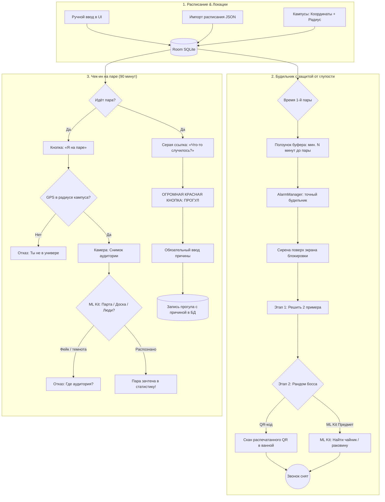

# StudyForLazy (трекер посещаемости и карательный будильник)

> **Персональный контролёр посещаемости пар для Android.**
> Без платных облачных API, регистраций и подписок: всё работает локально на устройстве — Kotlin, Jetpack Compose и Google ML Kit.

[-4285F4?logo=jetpackcompose&logoColor=white)](#)

---

## Зачем это нужно

1. **Чтобы не проспать.** Будильник привязан к расписанию и не даёт поставить подъём впритык к первой паре: есть ползунок минимального буфера, по умолчанию 60 минут до начала.
2. **Чтобы действительно встать.** Сирену не выключить, пока не решишь два примера и не пройдёшь случайного босса: отсканируешь распечатанный QR-код в ванной или найдёшь камерой нужный предмет — чайник, кружку, раковину.
3. **Чтобы не было самообмана на парах.** Подтверждение открыто все 90 минут пары. Зачесть пару можно только в радиусе кампуса (один GPS-замер на 5 секунд) и с живым фото аудитории, где ML Kit видит парты, доску или людей.
4. **Чтобы прогул оставался прогулом.** Под кнопкой чек-ина есть маленькая серая ссылка «Что-то случилось?». Она открывает большую красную кнопку «ПРОГУЛ» с обязательным полем причины — причина сохраняется в календаре навсегда.

---

## Дизайн: Warm Industrial Cyberpunk

- Тёплый графитовый фон (`#1E1C1A` / `#282523`), янтарный акцент (`#FF9E3B`), неоново-мятный `secondary` (`#4AF699`). Красный `#FF2A54` зарезервирован под прогулы, комиссию и опасные состояния.
- Все карточки и чипы — со срезанными углами (`CutCornerShape`), чтобы напоминали шарды памяти, а не обычные скруглённые плашки.
- **SD-чип дня.** Полная янтарная заливка — был на всех парах. Сплошная красная — прогул. Половинчатая, янтарь сверху и красный снизу, — частичный прогул. Будущий день остаётся прозрачным, только тонкая янтарная рамка. Выбранный день отмечается маркерами `▼` и `▲`.
- **Четыре вкладки:** Расписание, Будильник, Статистика, Дедлайны. У дедлайнов приоритеты от лабораторной до комиссии или пересдачи, сортировка по важности и близости даты.
- **В планах:** виджет на рабочий стол на Jetpack Glance — та же лента недели из SD-чипов, тап открывает нужный день в приложении.

---

## Архитектура и сценарий работы

---

## Дорожная карта

- [x] **Этап 0. Архитектурный каркас (v0.0.1)**
  - Модульная архитектура на Jetpack Compose (Kotlin 2.0).
  - Атомарные файлы по 80–90 строк — с ними проще работать ИИ-агентам.
  - Навигация на четыре экрана: Расписание, Дедлайны, Будильник, Статистика.
- [x] **Этап 1. Данные и киберпанк-тема (v0.0.2)**
  - Палитра Warm Industrial Cyberpunk со срезанными углами (`CutCornerShape`).
  - Room SQLite: пары, кампусы Военмеха, дедлайны, посещения.
  - Автоматический сидинг расписания из `schedule_sample.json` при первом старте.
  - Карусель недели из SD-карточек: частичный прогул закрашивается в два цвета.
  - Экран дедлайнов с градацией важности вплоть до комиссии и живой индикацией сроков.
- [x] **Этап 2. Боевой механизм будильника (v0.1.0-alpha)**
  - Точный планировщик на `AlarmManager.setAlarmClock()` и пермишен `USE_EXACT_ALARM`.
  - Динамический лимит подъёма в `AlarmTimeCalculator`: не позже чем за N минут до первой пары.
  - Фоновый `AlarmService` с громким аудиопотоком `USAGE_ALARM` и вибрацией.
  - Полноэкранный `AlarmActivity` поверх экрана блокировки, свайп назад заблокирован.
  - Первая фаза пробуждения: две арифметические задачи, без них звук не выключается.
- [ ] **Этап 3. Утренние боссы ML Kit (вторая фаза пробуждения)**
  - Локальный генератор и сканер QR-кодов (ML Kit Barcode Scanning).
  - CameraX и ML Kit Image Labeling для поиска предметов: чайник, раковина, кружка.
  - После математики босс выбирается случайно.
- [ ] **Этап 4. Кастомизация будильника и звука**
  - Своя мелодия или сирена из памяти телефона.
  - Настройка громкости и режима нарастания.
- [ ] **Этап 5. Чек-ин на паре и «Протокол стыда»**
  - Быстрый GPS-чек по координатам корпусов Военмеха.
  - Фотофиксация аудитории с проверкой через ML Kit, без доступа к галерее.
  - Серая кнопка чистосердечного признания с обязательной причиной прогула в базе.
- [ ] **Этап 6. Виджет на рабочий стол (Jetpack Glance)**
  - Индустриальная лента из семи SD-чипов на домашнем экране Pixel 7, тап открывает нужный день.
