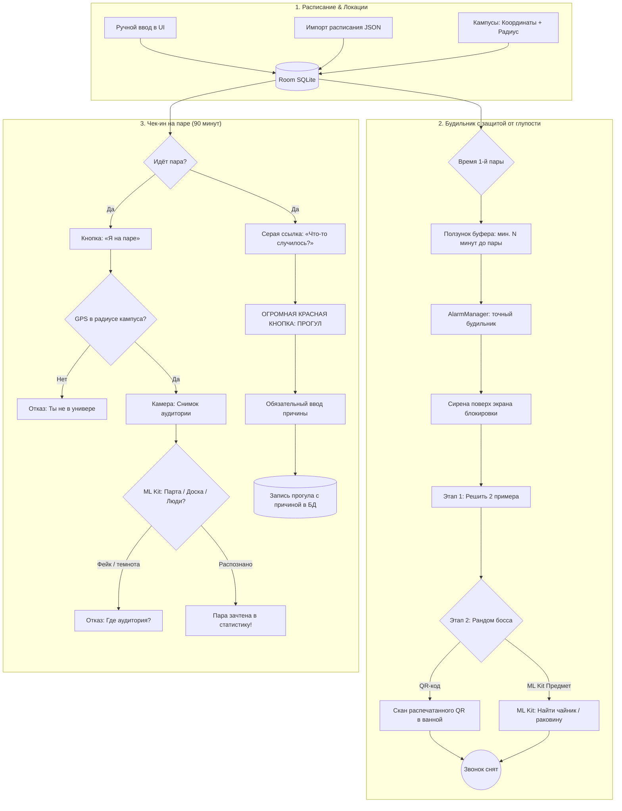

# 🎓 StudyForLazy (Трекер посещаемости & Карательный будильник)

> **Автономный персональный контролёр посещаемости пар для Android.** 
> Никаких платных облачных API, регистраций и подписок — всё работает локально на устройстве с помощью Kotlin, Jetpack Compose и Google ML Kit.

[-4285F4?logo=jetpackcompose&logoColor=white)](#)

---

## Зачем это нужно?

1. **Не даёт проспать:** Будильник привязан к расписанию и запрещает ставить время подъёма впритык к первой паре (настраиваемый ползунок буфера: например, минимум за 60 минут до начала).
2. **Заставляет встать с кровати:** Чтобы заткнуть сирену, нужно решить 2 примера, а затем пройти рандомного босса: отсканировать распечатанный QR-код в ванной или найти камерой предмет (чайник/кружку/раковину).
3. **Исключает самообман на парах:** Окно подтверждения активно все 90 минут пары. Зачесть пару можно только находясь физически в радиусе кампуса (разовый 5-секундный GPS-чек) и сделав живое фото аудитории, где ML Kit распознает парты/доску/людей.
4. **Протокол стыда:** Под кнопкой чек-ина есть маленькая серая надпись «Что-то случилось?». Нажатие вызывает огромную красную кнопку «ПРОГУЛ» с обязательным вводом причины, которая навсегда сохраняется в календаре.

---

## Архитектура и сценарий работы

---

## Roadmap

- [x] **Этап 0:** Модульный каркас на Jetpack Compose (Kotlin 2.0), базовые модели и навигация.
- [ ] **Этап 1:** База данных Room (расписание числитель/знаменатель, кампусы с радиусом GPS, импорт из `schedule.json`, ползунок утреннего буфера).
- [ ] **Этап 2:** Будильник-Цербер (`AlarmManager`, `ForegroundService`, полноэкранный оверлей поверх локскрина, расчёт лимита времени до 1-й пары).
- [ ] **Этап 3:** Утренние боссы (встроенный генератор QR-кодов, 2 примера + камера с ML Kit Barcode & Image Labeling).
- [ ] **Этап 4:** Зачёт пары и «Протокол Стыда» (GPS-чек на 5 сек, фото аудитории через CameraX + ML Kit, серая ссылка -> красная кнопка прогула с записью причины).
- [ ] **Этап 5:** Статистика и календарь с историей посещений и кликабельными причинами прогулов.
